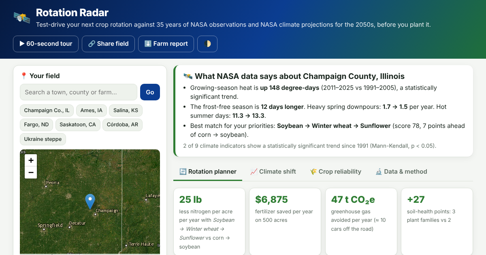

<p align="center"></p>

# AgriHaven

**Test-drive your next crop rotation against 35 years of NASA observations and NASA's 2050s climate projections, before you plant it.**

NASA Space Apps Challenge 2026 · Challenge: **Field Shift: Adapting Farms with NASA Data** · Team AgriHaven, Chicago

### 🌐 Live demo: **https://agrihaven-nasa.vercel.app**



---

## The problem

Farmers plan crop rotations from experience: "what worked for my parents." But the climate that experience was built in no longer exists. In central Illinois, NASA data shows the growing season now has about **150 more degree-days of heat** and a **frost-free season about 12 days longer** than in 1991–2005. Heat waves and flash droughts like **2012** still wipe out whole seasons. Most farmers have no easy way to ask:

> *"Given how **my** field's climate has actually changed, which rotation will hold up best, and what does it do for my soil?"*

## Our solution

AgriHaven is a free web app. Click any field on Earth and it will:

1. **Download 35 years of daily NASA POWER weather** (1991–present) and **SoilGrids topsoil** data for that exact point.
2. **Show how the climate has really shifted.** It covers 8 farm-relevant indicators (heat units, frost-free season, hot days, heavy spring rain, dry spells, NASA root-zone soil wetness and more), each tested for a statistically significant trend (Mann-Kendall + Sen's slope).
3. **"Grow" 10 crops in every one of those 35 real seasons.** Each crop is checked against its heat-unit needs, flowering heat stress, water supply (rain plus NASA soil moisture), frost and winterkill, and soil pH. The result is a year-by-year reliability strip for each crop.
4. **Rank 11 rotations, or one you build yourself.** Scores combine **climate resilience**, **soil health** (diversity, legumes, winter cover, perennials) and **fertilizer need**, weighted by what matters to the farmer.
5. **Fast-forward to the 2050s** with **NASA NEX-GDDP-CMIP6** projections from three independent climate models (GFDL-ESM4, MRI-ESM2-0, ACCESS-CM2) under moderate (SSP2-4.5) and high (SSP5-8.5) emissions. Rotations are re-ranked under every model separately, so you can see whether the recommendation is robust. A custom what-if slider is also available.
6. **Show what switching is worth:** nitrogen fertilizer saved, dollars, tonnes of CO₂e avoided and soil-health gain for *your* acreage and fertilizer price.
7. **Tell the field's story** in six data-driven chapters (the climate it was built for, the year everything went wrong, the new normal, the 2050s, a plan that holds) in **English or Spanish**, with **read-aloud**.
8. **Speak the farmer's language:** a 🌐 picker in the header (or the phone's More menu) translates the whole site, including every generated chapter, table and recommendation, into **130+ languages**, among them Hindi, Tamil, Telugu, Punjabi, Bengali, Swahili, Hausa, Yoruba, Amharic, Portuguese, French, Arabic (right-to-left), Chinese, Indonesian and Vietnamese. The choice is remembered and read-aloud switches to that language.
8. **Check the season right now:** NASA POWER near-real-time data (~3-day latency) compared with the same dates in every year since 1991, turned into timely advice (plant, wait, irrigate, seed a cover crop).
9. **Hear the data:** any climate trend can be played as sound (sonification) for accessibility.
10. **Farm-operations indicators** from 11 NASA POWER variables: earliest planting day (soil-surface temperature), spring field-work days, fungal-disease weather days and hot nights, plus FAO-56 Penman-Monteith evapotranspiration.
11. **Soil conservation:** tonnes of topsoil lost per acre (USDA RUSLE with NASA rainfall and SoilGrids erodibility) and soil-carbon gained by each rotation, using a 1-metre SoilGrids soil profile.
12. **🎮 The 2050 Farm Challenge:** play 8 seasons of 2050s weather (real NASA years warmed by NEX-GDDP-CMIP6), then see how you compare with AgriHaven's plan on the same weather.
13. **🛰️ Season from space:** a MODIS NDVI time-lapse of the crop greening up and drying down, plus NASA layers for plant productivity (GPP), land surface temperature, land cover, SMAP soil moisture and GPM IMERG rainfall.
14. **Explain everything in plain language**, with a 60-second guided tour, a shareable field link and a printable farm report.

Satellite context layers from **NASA GIBS** (MODIS NDVI vegetation greenness, SMAP root-zone soil moisture, SEDAC croplands) show what's growing around the field right now.

## Our brief, and where each part lives

| Brief item | Where in AgriHaven | Data |
|---|---|---|
| **Mission: Compare rotations** | Rotation planner, ⚖️ Compare & risk (side-by-side table) | All |
| **Mission: Reveal tradeoffs** | Tradeoff map (climate resilience vs soil health vs fertilizer), green/red best–worst table | Crop model, RUSLE, N budget |
| **Mission: Understand risk** | Poor-season odds, worst season, Water Certainty Rate, 2012/2019 validation | NASA POWER |
| **Mission: Make uncertainty visible** | 10–90 % outcome bars today vs 3 NASA climate models, rank ranges, p-values | NEX-GDDP-CMIP6 |
| **Factor 1: Radar analysis** | 🛰️ Satellite lab card 2: latest pass, backscatter brightness, surface-roughness index | NASA-ISRO **NISAR** (L-band), NASA **OPERA** RTC (Sentinel-1 C-band) |
| **Factor 2: Heat shifts** | Climate shift tab, heat-index trend, hot nights, degree-days | NASA POWER |
| **Factor 3: Rainfall changes** | Season rain, spring downpours, dry spells, water balance; GPM IMERG map layer | NASA POWER, GPM |
| **Factor 4: Water Certainty Rate** | Share of seasons where rain + stored soil water covered crop demand (Kc × FAO-56 Penman-Monteith ET₀) | NASA POWER, SoilGrids |
| **Factor 5: Soil ↔ nutrients** | Soil N supply, C:N, CEC, pH nutrient-availability bars, N budget per rotation | SoilGrids |
| **Research 1: Infrared 750–1400 nm + heat index** | MODIS bands 7-2-1 (band 2 = 841–876 nm NIR) image + NWS heat index with Optimal/Caution/Danger rating | MODIS, NASA POWER |
| **Research 2: Radar backscatter** | As factor 1. X-band is commercial/European, so NASA's public L- and C-band radar is used and explained | NISAR, OPERA |
| **Research 3: Vegetation index (NDVI) + density** | Live NDVI for the field, decoded from MODIS pixels, with High/Moderate/Low density | MODIS NDVI |
| **Research 4: Thermal raster (temperature + moisture)** | MODIS land surface temperature (°C) + root-zone moisture (%) + SMAP m³/m³ | MODIS LST, SMAP, POWER |
| **Research 5: NASA public observation data** | Every source listed with live status; request URLs in Data & method | All |
| **Research 6: Soil moisture** | Surface / root zone / profile + SMAP + percentile vs 35 years | NASA POWER, SMAP |
| **Research 7: Crop cycle in phases** | NDVI season curve with green-up / peak / senescence + corn & soybean stage calendar from heat units | MODIS, NASA POWER |
| **Research 8: UV index** | CERES all-sky UV via NASA POWER, est. midday rating, 2001–present trend | NASA POWER (CERES) |

Values like NDVI, temperature and moisture are **read live for each field** from NASA imagery: GIBS tiles are colorized with published colormaps, and AgriHaven converts each pixel's color back into the physical value.

## NASA data used

| Dataset | Use |
|---|---|
| [NASA POWER](https://power.larc.nasa.gov/) Agroclimatology daily API (MERRA-2 / CERES / satellite) | 12 variables, 1991–2025 + near-real-time: T2M_MAX, T2M_MIN, T2MDEW, RH2M, WS2M, ALLSKY_SFC_SW_DWN, ALLSKY_SFC_UV_INDEX, PRECTOTCORR, TS, GWETTOP, GWETROOT, GWETPROF |
| NASA GIBS: MODIS NDVI, MODIS GPP, MODIS LST, MODIS 7-2-1 reflectance, MODIS land cover, SMAP L4, GPM IMERG, SEDAC croplands | Map layers, NDVI time-lapse, and per-field values decoded from pixels |
| NASA-ISRO NISAR L2 GCOV (L-band radar), NASA JPL OPERA RTC-S1 (C-band radar) via GIBS | Radar backscatter and surface-roughness index |
| [NASA NEX-GDDP-CMIP6](https://www.nccs.nasa.gov/services/data-collections/land-based-products/nex-gddp-cmip6) v2.0 (NASA Center for Climate Simulation) | Daily downscaled Tmax, Tmin and precipitation, 3 models × SSP2-4.5 / SSP5-8.5, turned into monthly change factors (`tools/`) |
| [NASA GIBS](https://nasa-gibs.github.io/gibs-api-docs/): MODIS Terra NDVI 8-day | Current crop greenness map layer |
| NASA GIBS: SMAP L4 root-zone soil moisture | Current soil moisture map layer |
| NASA GIBS: SEDAC Agricultural Lands, Croplands 2000 | Where cropland is |
| [ISRIC SoilGrids 2.0](https://soilgrids.org) (partner data) | Topsoil texture, pH, organic carbon, CEC |
| FAO Ecocrop / FAO-56, US extension guides | Crop thresholds, Hargreaves reference evapotranspiration |
| USDA-NRCS available-water values by texture | Root-zone water storage from SoilGrids texture |
| IPCC 2019 Refinement (EF1) and AR6 GWP | N₂O and CO₂e estimates |

## Validation

The spring field-work-day indicator, calibrated only to USDA's typical average, independently finds **2019** (Illinois's record-wet, late-planting spring) with just 2 workable days and **2012** with 46. Without being tuned to any particular year, the model also ranks **2012**, the historic US drought, among the two worst corn seasons in central Illinois. It also flags **2005**, a severe Illinois drought. The FAO-56 radiation code reproduces FAO's own worked example, and July reference ET in central Illinois comes out at 5–6 mm/day, as expected. `npm test` runs 23 automated checks covering the statistics, unit conversions, climate-model deltas, impact maths and scoring logic.

### Rebuilding the NASA projections
```bash
python3 tools/fetch_nex_gddp.py                     # downloads from NASA NCCS THREDDS (~4 min per region)
python3 tools/build_projections.py proj_raw.json    # writes data/projections.json
```

## Run it

It's a static site with no build step and no API keys.

```bash
python3 -m http.server 8000   # then open http://localhost:8000
npm test                      # 9 tests, Node 18+
```

If the live APIs are unreachable during a demo, the app offers a bundled **offline sample** (real NASA POWER data for Champaign County, IL).

## Project structure

```
index.html          app shell
css/style.css       styles (light/dark, mobile, print report)
js/api.js           NASA POWER, SoilGrids, GIBS, geocoding
js/analysis.js      climate indicators, crop-year model, Mann-Kendall / Sen's slope
js/crops.js         crop library (thresholds and sources)
js/rotations.js     rotation scoring and plain-language explanations
js/app.js           UI: map, charts, tabs
js/projections.js   NASA NEX-GDDP-CMIP6 scenarios
js/impact.js        fertilizer, $ and CO2e impact
data/               offline sample (real NASA POWER + SoilGrids) + projections.json
tools/              scripts that build projections.json from NASA NEX-GDDP-CMIP6
tests/run.js        tests
docs/               pitch, demo script, judging plan
```

## Limitations

NASA POWER is a ~50 km grid, so it gives regional climate, not microclimate. The 2050s projections use 3 models × 2 sample years per period, precomputed for the preset regions; nearby fields (within ~600 km) use the nearest region. Crop thresholds are generic screening values. Scores compare options; they are not yield forecasts or financial advice. AgriHaven helps a farmer start a conversation with their agronomist. It doesn't replace one.

## Use of AI

AI coding assistants helped write the code and documentation. All data comes from the cited sources, and the team reviewed the model logic and results.

## Team AgriHaven (NASA Space Apps Chicago 2026)

- **Harish Ramasubramanian**
- **Dhishant Kishorekumar**
- **Giridhar Krishnan**
- **Atharv Patel**

*Not affiliated with or endorsed by NASA.*
